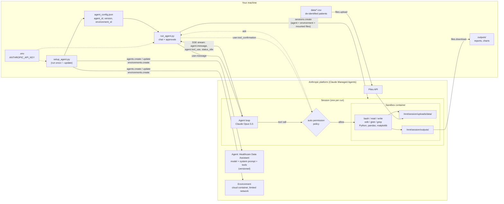

# Healthcare Data Assistant: Claude Managed Agent

A healthcare analytics agent built on [Claude Managed Agents](https://platform.claude.com/docs/en/managed-agents). You give it de-identified patient data, and it analyses cohorts, readmissions and lab values, flags values that need clinical review, and produces charts and reports. Anthropic runs the agent loop and gives each session its own cloud Linux container, where the agent runs Python on your data.

> **Not a medical device.** The agent supports clinicians and quality teams with data analysis. It does not diagnose or recommend treatment. Use de-identified data only.

- **Model:** `claude-opus-5-5`
- **Tools:** built-in toolset `agent_toolset_20260401` (bash, read, write, edit, glob, grep) with the `auto` permission policy. Web tools are off.
- **Environment:** cloud container, limited networking (only package installs such as pandas and matplotlib are allowed)
- **Sample data:** `data/sample_patients.csv` has 60 synthetic admissions: diagnosis (ICD-10), medication, length of stay, BP, HbA1c, eGFR, BMI, smoking status and 30-day readmission

## Architecture



### Flow

1. **Setup (once):** `setup_agent.py` creates the **agent** (model, healthcare system prompt, tools) and an **environment** (container config), then saves their IDs to `agent_config.json`. Running `--update` saves prompt or tool changes as a new agent version.
2. **Session start:** `run_agent.py` uploads every CSV in `data/` with the Files API and creates a **session** that mounts them at `/mnt/session/uploads/data/`.
3. **Chat:** your question is sent as a `user.message`. The agent loop on Anthropic's side decides which tools to call and runs them in the session's sandbox container.
4. **Permissions:** under the `auto` policy the server checks each tool call. Safe calls run, risky ones are blocked, and uncertain ones pause until you answer the `Allow this tool call? [y/N]` prompt.
5. **Streaming:** replies and tool activity stream back over SSE until the session goes idle.
6. **Outputs:** files the agent saves to `/mnt/session/outputs/` are downloaded to your local `outputs/` folder.

## What it can do

| Area | Examples |
|------|----------|
| Cohort overview | Patients by diagnosis, age and sex mix, average length of stay |
| Readmissions | 30-day readmission rate by diagnosis, smoking status or age band |
| Lab and vitals flags | HbA1c ≥ 9%, eGFR < 60, systolic BP ≥ 140, BMI ≥ 30 |
| Explanations | ICD-10 codes, lab values and medications in plain language |
| Deliverables | Charts (PNG), quality reports (Markdown), filtered CSVs |

**Built-in safeguards** (in the system prompt): no diagnosis or prescribing, numbers backed by the data with the method shown, a stop if direct identifiers such as names or phone numbers appear, and urgent values (for example systolic BP ≥ 180) called out at the top of the answer.

## Setup

```bash
pip install -r requirements.txt
cp .env.example .env        # then put your key in .env
python setup_agent.py       # one time only
```

## Usage

```bash
# Interactive chat (shows example questions)
python run_agent.py

# One question
python run_agent.py -q "Which diagnoses have the highest 30-day readmission rate?"

# Analyse your own de-identified file(s)
python run_agent.py --data path/to/admissions.csv
```

Example questions:

- *Give me a cohort overview: patients by diagnosis, average age and length of stay.*
- *List diabetic patients with HbA1c ≥ 9% and explain why that matters.*
- *Chart 30-day readmission rate by diagnosis and save it as a PNG.*
- *Write a one-page quality report as report.md with your key findings.*

Each run prints a trace link to watch the session in the Claude Console.

## Configuration

- **Change the prompt, model or tools:** edit `setup_agent.py`, then run `python setup_agent.py --update` to save it as a new version of the same agent.
- **Start over with a new agent:** `python setup_agent.py --force`
- **Enable web search and fetch** (for example to look up clinical guidelines): remove the `web_fetch` / `web_search` lines in `TOOLS`, then run `--update`. Under limited networking, the web tools can only reach hosts listed in the environment's `allowed_hosts`.

## Files

| File | Purpose |
|------|---------|
| `setup_agent.py` | Creates or updates the agent and environment |
| `run_agent.py` | Uploads data, starts a session, and streams the chat |
| `data/sample_patients.csv` | Synthetic de-identified patient dataset |
| `agent_config.json` | Saved agent and environment IDs (not secret) |
| `.env.example` | Template for `ANTHROPIC_API_KEY` |

`.env` and `outputs/` are git-ignored.
